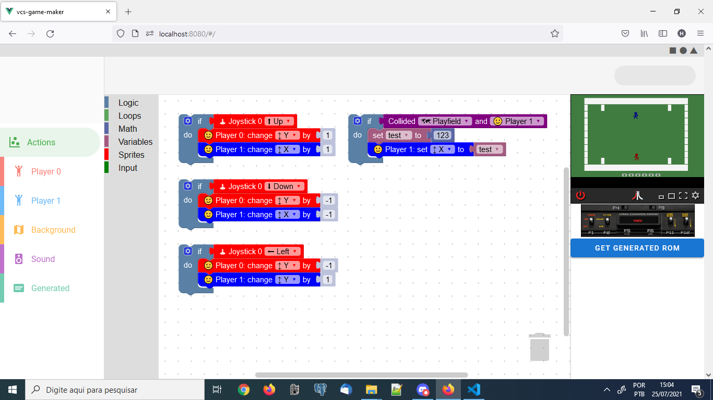

# vcs-game-maker

VCS Game Maker is a visual environment for building Atari 2600 games. Build your game's logic with [Blockly](https://www.blockly.com/) blocks, and behind the scenes VCSGM generates [batari Basic](https://github.com/batari-Basic/batari-Basic) source code (along with a bit of assembly), compiles it into an Atari 2600 ROM, and runs that ROM in a built-in emulator preview, using either [6502.ts](https://github.com/6502ts/6502.ts) or [Gopher2600](https://github.com/jetsetilly/gopher2600).

Gopher2600 is compiled to WebAssembly - see `tools/gopher2600-wasm`.

*This is very much a work-in-progress.*




## Project setup
```
npm install
```

### Compiles and hot-reloads for development
```
npm run serve
```

### Compiles and minifies for production
```
npm run build
```

### Lints and fixes files
```
npm run lint
```

### Customize configuration
See [Configuration Reference](https://cli.vuejs.org/config/).


## License

VCS Game Maker is licensed under the [PolyForm Shield License 1.0.0](LICENSE).

The original code, by Haroldo de Oliveira Pinheiro ([haroldo-ok](https://github.com/haroldo-ok/vcs-game-maker)), is under the MIT License: see [LICENSE-MIT-haroldo](LICENSE-MIT-haroldo). That code stays available under the MIT License, and its copyright and permission notice go with every copy of it.
